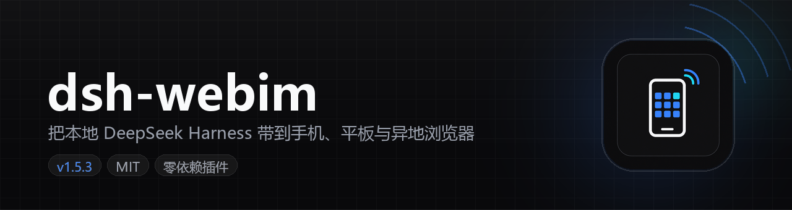
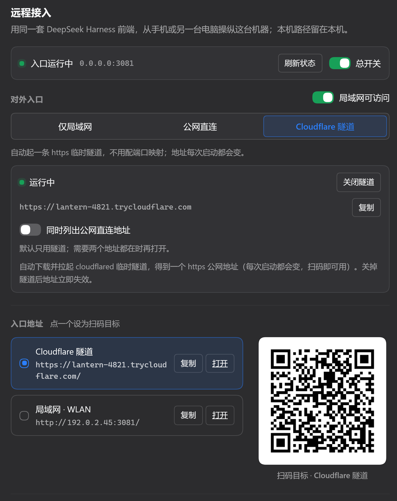
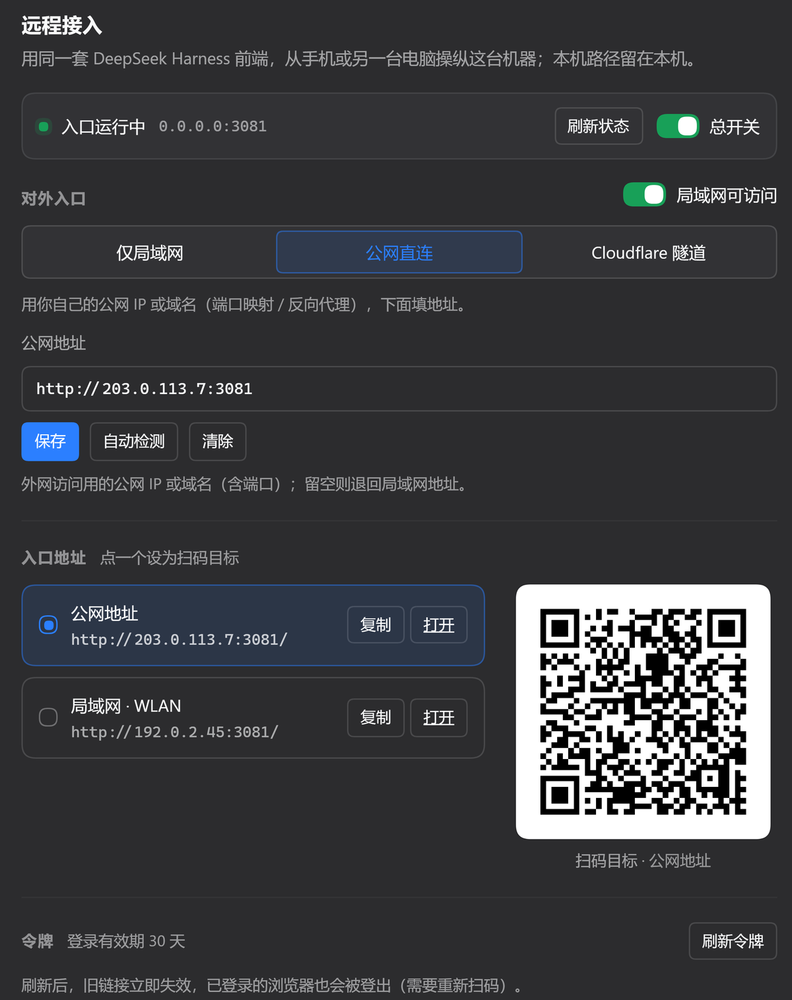
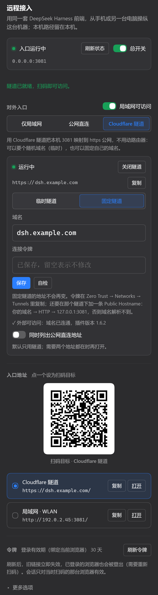
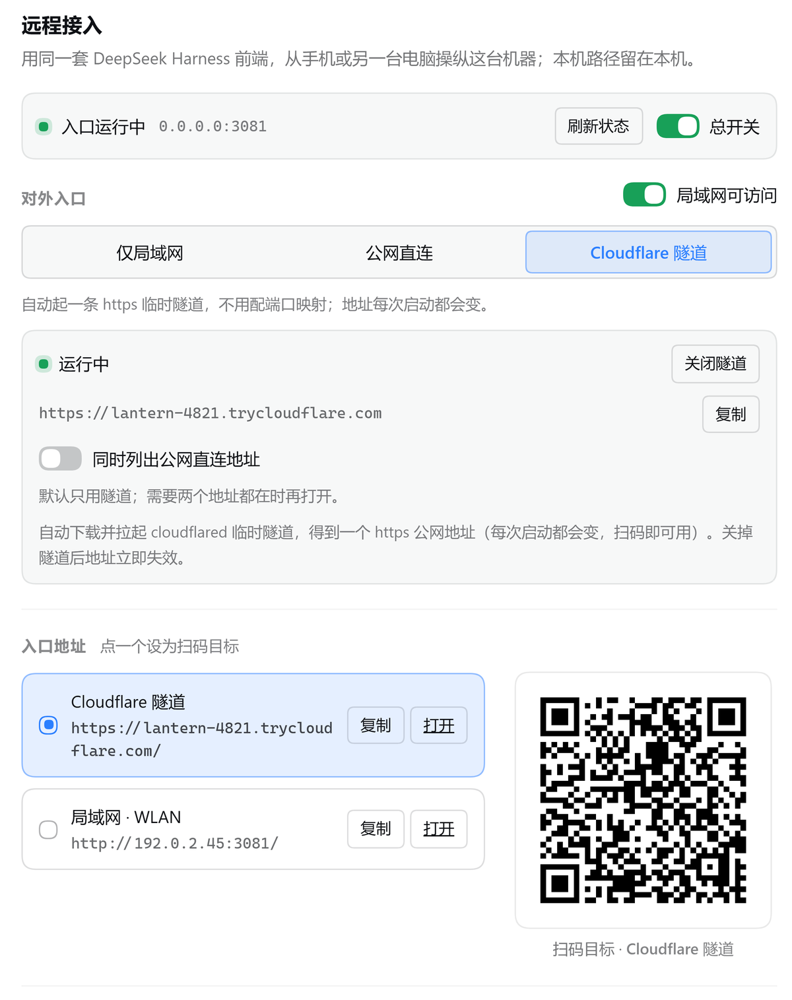
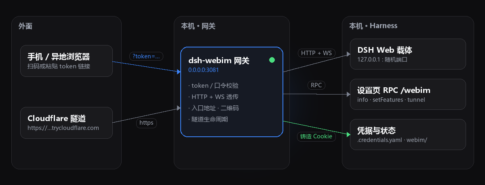

<p align="center">
  
</p>

<p align="center">
  
  
  
  
  <a href="https://github.com/shimiei/dsh-webim/actions/workflows/test.yml"></a>
</p>

<p align="center">
  <b>不改 DeepSeek Harness 的一行代码，就把这台机器的 DSH 变成手机、平板、异地浏览器都能打开的网站。</b><br>
  复用同一套 DSH 前端 · token 扫码即进 · 内置 Cloudflare 隧道 · 手机层单独适配 · 零运行时依赖
</p>

---

## 这是什么

DeepSeek Harness（DSH）默认只监听 `127.0.0.1` 的随机端口，同一个 Wi-Fi 下的手机都连不上，更别说人在外面。

`dsh-webim` 是一个 DSH 插件：它在 `0.0.0.0:3081` 起一个反向代理，把本机 Harness 的 HTTP 与 WebSocket 原样桥接出去，并在 DSH 的设置页里长出一块**「远程接入」**面板，负责入口地址、二维码、令牌、隧道和一堆运行时开关。

**它不修改 DSH 本体**：前端还是那套前端，工作区、会话、插件全都在，只是多了一个经过 token 校验的入口。远程浏览器拿到的是 DSH 自己的 UI，实际驱动的是这台机器上的 Harness 进程——本地绝对路径（工作区、`file://` 引用、会话存储）永远留在服务端。

| 能力 | 说明 |
| --- | --- |
| 同一套前端 | 反向代理透传 HTTP + `Upgrade`（`/api/remote.mux` 实时流），不劫持、不改写 DSH 的页面 |
| 扫码即进 | 设置页内联 SVG 二维码（自研编码器，无外部图片请求，绕开 CSP `img-src`），扫完直接落到 DSH |
| 令牌可轮换 | 32 字节 base64url token，一次刷新即硬切：旧链接、旧二维码、已登录会话一起失效 |
| 三种接入方式 | 仅局域网 / 公网直连（自己的 IP 或域名）/ Cloudflare 快速隧道；一次只开一种，也能让隧道与公网并存 |
| 内置隧道 | 自动下载并拉起 `cloudflared` quick tunnel，几秒后拿到 `https://xxx.trycloudflare.com`，不用配端口映射 |
| 手机层 | 窄屏抽屉、输入框不再被键盘顶飞、设置页单列，`interactive-widget=resizes-content` |
| 运行时开关 | 总开关 / 局域网 / 公网 / 移动端 / 隧道 / 文件查看 / 路径转链接 / 浮动入口，全都不用重启 |
| 主题自适应 | 浅色/深色跟随 Harness 本身：浮标、面板、提示条、手机抽屉、文件浏览页全部同步，没有一块"深色孤岛" |
| 远程安全 | 令牌门 + 会话绑定浏览器 + 失败限流与封禁 + 上游 Cookie 由本机 `.credentials.yaml` 铸造，凭据不出机器 |
| 零依赖 | 只用 Node 标准库：QR 编码器、PNG 编码器、代理、二维码都是自己写的 |

## 截图

> 取自真实运行中的面板，**所有 IP、域名、令牌与二维码都已替换成文档占位值**（RFC 5737 / `example.com`）。

<p align="center">
  
  
</p>

<p align="center">
  
  
  <br>
  <sub>手机端（390pt）：单列、入口卡片与二维码，扫码即进 · 右为浅色主题</sub>
</p>

## 三种接入方式

设置页只有一块分段控件，选完即生效（内部就是三个布尔开关的组合）：

| 方式 | 实际写入 | 效果 |
| --- | --- | --- |
| **仅局域网** | `{lan: true, public: false, tunnel: false}` | 只出 `http://<本机 IP>:3081/?token=…`，同一 Wi-Fi 可用，不暴露到公网 |
| **公网直连** | `{lan: true, public: true, tunnel: false}` | 先列你保存的公网 IP / 域名（自己做端口映射或反代），再列局域网地址 |
| **Cloudflare 隧道** | `{lan: true, public: false, tunnel: true}` | 启动后追加 `https://xxx.trycloudflare.com`；公网地址默认不参与，需要时勾卡片里的「同时列出公网直连地址」 |

三个开关各自独立，也各有含义：

| 开关 | 关掉之后 |
| --- | --- |
| `总开关` | 监听彻底停掉：3081 无监听、隧道一起停、入口列表清空；桌面端不受影响 |
| `局域网可访问` | 监听从 `0.0.0.0` 重绑到 `127.0.0.1`，同网段设备连不上，隧道照旧（它连的是本机回环） |
| `公网入口` | 不再展示保存的公网地址，**隧道不受影响**（v1.5.1 起两者解耦） |

二维码永远跟随**被点选的那张入口卡**，不是"排在第一个的那个"；指向消失时自动回落到列表第一项，不会留死链。

## 快速开始

要求：Windows / macOS / Linux，Node ≥ 18，已安装并能正常打开 DeepSeek Harness。

```powershell
git clone https://github.com/<you>/dsh-webim.git
cd dsh-webim

# 装进 DSH 的 desktop profile（建链接 + 写 patch，幂等）
node scripts/install.mjs
```

然后重启 / 刷新 DSH 窗口，打开 **设置 → 远程接入**：

1. 顶栏确认「入口运行中」，记住 `host:port`（默认 `0.0.0.0:3081`）；
2. 选一种接入方式（想最省事就选 **Cloudflare 隧道**，等几秒拿到 https 域名）；
3. 点入口卡片选中它，扫右侧二维码，或直接复制链接。

想手动安装也可以：在 `<profile>/node_modules/` 下指向本仓库建一个链接，把 `dsh-webim` 加进 profile 的 `dsh.profile.bundles`，再在 `cordis.patch.yml` 里加一段配置（见下一节）。

### 不用插件也能跑（调试用）

```powershell
node bin/serve.mjs --host 0.0.0.0 --port 3081
```

它和插件共用 `lib/gateway.js`，只是没有设置页，参数从命令行来。

## 配置

配置写在 profile 的 `cordis.patch.yml`（用户覆盖层），或直接改插件自带 `cordis.patch.yml` 的默认值：

```yaml
- id: dsh-webim
  config:
    enabled: true             # 插件是否加载（与「是否监听」是两件事）
    host: "0.0.0.0"           # 监听地址；0.0.0.0 = 所有网卡
    port: 3081
    password: ""              # 口令门；留空 = 只认 token 链接
    accessToken: ""           # 固定 token；留空 = 自动生成，可在设置页刷新
    publicUrl: ""             # 公网 IP / 域名（含端口），如 http://1.2.3.4:3081
    sessionDays: 30
    sessionBind: 'ua'        # 'ua' = 会话只对扫码那台浏览器有效；'off' = 拿到 cookie 就能进
    maxFailures: 8            # 同一 IP 失败多少次锁定
    failureWindowMinutes: 10
    blockMinutes: 15
    allowedRoots: []          # 远程文件查看允许的根；空 = 所有盘符
    deniedPaths: []           # 额外拒绝路径（默认已拒绝 $DSH_HOME 里的凭据）
    linkifyPaths: true
    logRequests: false
    tunnelBinary: ""          # 指定现成的 cloudflared；留空 = 用下面自动下载的那份
    tunnelAutoInstall: true   # false = 不自动下载 cloudflared
    features:                 # 只提供首启默认值，运行时以 features.json 为准
      enabled: true
      lan: true
      public: true
      mobileUi: true
      tunnel: false
      fileBrowser: true
      linkifyPaths: true
      pill: true
```

运行时状态都在 `$DSH_HOME/webim/`：`token.json`、`public-url.txt`、`qr-target.txt`、`features.json`、`tunnel.json`、`plugin.log`（插件日志，排障用）、`cloudflared/`。删掉对应文件即回到默认。

## 工作原理

<p align="center">
  
</p>

几条关键设计：

- **只在入口校验**：token 或口令任一通过即铸造 DSH 自己的 `dsh-auth-*` Cookie，之后由上游继续认这个 Cookie；网关不缓存任何会话内容。
- **WebSocket 桥接**：`Upgrade` 直接接到上游，`/api/remote.mux` 的实时流不断。
- **隧道与监听解耦**：隧道连的是本机回环，所以关掉局域网、甚至只绑 `127.0.0.1`，隧道仍然可用。
- **设置页 RPC 先回包再干活**：切模式会重绑端口，导致"回包跟着旧连接一起死"；因此面板先就地更新，再后台轮询等状态回来。
- **QR 自研**：Byte 模式、版本 1–20、L/M/Q/H、8 种掩码，输出内联 SVG；`tests/qr.test.mjs` 与 Python `qrcode` 做了矩阵对照。

## 目录结构

```
lib/           网关、代理、安全、文件、隧道、二维码、入口地址推导
assets/        注入到 DSH 前端的小补丁（移动端抽屉、状态胶囊、路径点击）
client.js      设置页（React，走 DSH 的 slot 与设计 token）
bin/serve.mjs  独立模式入口
scripts/       安装 / 卸载
tests/         86 个测试（安全、网关、token、插件、客户端契约、二维码、隧道）
tools/         无依赖调试工具（CDP 探针、截图脱敏、banner / 架构图合成）
docs/          banner、图标、README 截图
```

## 开发与测试

```powershell
node --test tests/*.test.mjs
```

当前 **86 个用例全部通过**（约 1.7 秒）：安全 10、网关 16、token-only 6、token 10、host 插件 7、client 契约 12、二维码 11、功能开关 4、隧道 5、入口地址过滤 1。

界面另有几个零依赖探针（需先手动起 headless Edge 并打开调试端口）：

```powershell
node tools/probe-remote.mjs <debug-port> <入口链接> out.png --eval-file tools/eval-ui-report.mjs
node tools/make-shots.mjs    <debug-port> <入口链接> docs/shots   # 生成脱敏截图
python tools/make-banner.py                                      # 重新合成 banner 与图标
python tools/make-arch.py                                        # 重新绘制架构图
```

改完代码要让它生效：`node scripts/install.mjs` 触发宿主热重载；只改 `cordis.patch.yml` 里的注释不算变化，得动一个值（例如 `sessionDays` 30 ↔ 31）。

## 安全须知

远程入口意味着**别人拿到链接就等于坐在你的 DSH 前面**，请至少做到：

1. **别用弱口令**：口令门默认关闭，走 token；要开口令就给个像样的。
2. **公网优先用 HTTPS**：`Cloudflare 隧道` 天然 https；自己做端口映射时建议反代加证书，并透传 `X-Forwarded-Proto: https`（网关据此给 Cookie 加 `Secure`）。
3. **令牌会随刷新硬切**：刷新后旧链接、旧二维码、已登录浏览器全部失效，这是设计。
4. **会话绑定浏览器**：cookie 里带 User-Agent 指纹（`sessionBind: 'ua'`，默认），换设备/换浏览器复制 cookie 一律 401；手机在 Wi-Fi 与蜂窝间切换不受影响。想回到"拿到 cookie 就能进"的老行为，把它设成 `'off'`。
5. **文件查看有白名单**：默认拒绝 `$DSH_HOME` 里的凭据与状态目录，可用 `allowedRoots` / `deniedPaths` 收紧。
6. **不用就关总开关**：3081 会真的停掉，隧道一起停。

## 常见问题

| 现象 | 处理 |
| --- | --- |
| 设置了但手机连不上 | 确认防火墙放行 TCP 3081；`Get-NetTCPConnection -LocalPort 3081` 应有监听；路由器/云主机安全组也要放行 |
| 隧道一直起不来 | 首次要下 ~55 MB 的 `cloudflared`（看 `$DSH_HOME/webim/cloudflared/`）；企业网络挡 `github.com` / `*.trycloudflare.com` 时会失败；可用 `tunnelBinary` 指定现成二进制 |
| 点了隧道按钮没反应 | v1.5.1 起有转圈 + 计时 + 占位卡片；若 30 秒没域名，看 `$DSH_HOME/webim/plugin.log`（含 cloudflared 最后几行输出） |
| 切换模式后页面卡一下 | 预期行为：重绑端口会打断当前页面连接，面板每 1.2 秒自动重连，3–5 秒恢复 |
| 二维码扫出来不是我想的那个 | 二维码跟随**被点选**的卡片；点一下想要的那张，下方会写「扫码目标 · …」 |
| 刷新令牌后自己也进不去 | 设计如此：会话签名把 token 当盐，轮换后旧会话全部失效，重新扫码即可 |
| 端口被占（EADDRINUSE） | 已有旧网关在跑；插件用 `Symbol.for('dsh-webim.gateway.v1')` 注册表在 bind 前关掉上一代，`/__webim/ping` 的 `instance.tokenId` 可看是谁在应答 |

## 已知限制

- 隧道用的是 **quick tunnel**（免账号），域名每次启动都变，Cloudflare 也不保证可用性；长期使用请换 named tunnel + 自己的域名。
- 网关到本机 Harness 之间是**明文回环 HTTP**，本机进程可读；跨机安全靠外层 https。
- 只桥接 HTTP/WS，不做协议改写，所以 DSH 前端的所有能力都取决于上游本身。
- 移动端适配是"补丁式"的：DSH 大版本换 DOM 结构时，`assets/client.css` 里的选择器可能需要跟进。

## License

[MIT](LICENSE)。与 DeepSeek / DeepSeek Harness 官方无关，属于第三方插件。
